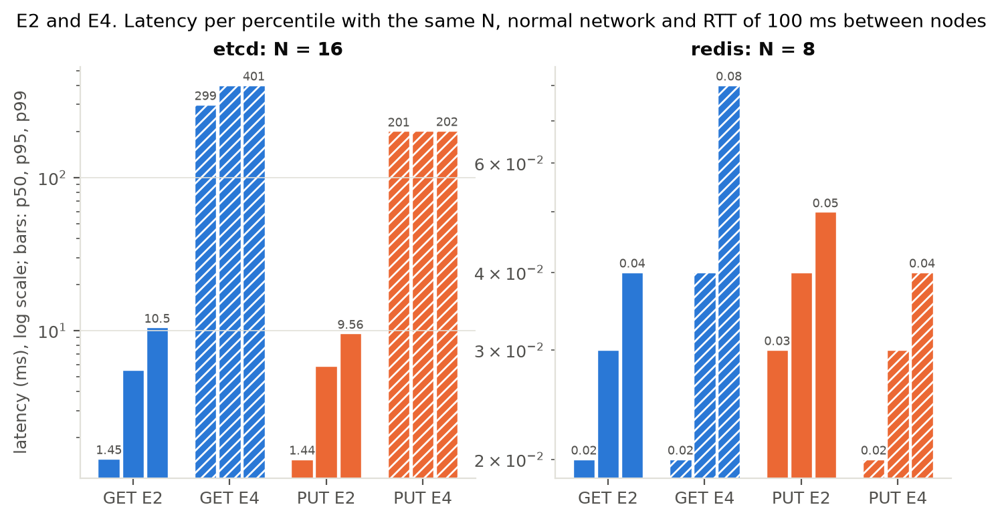
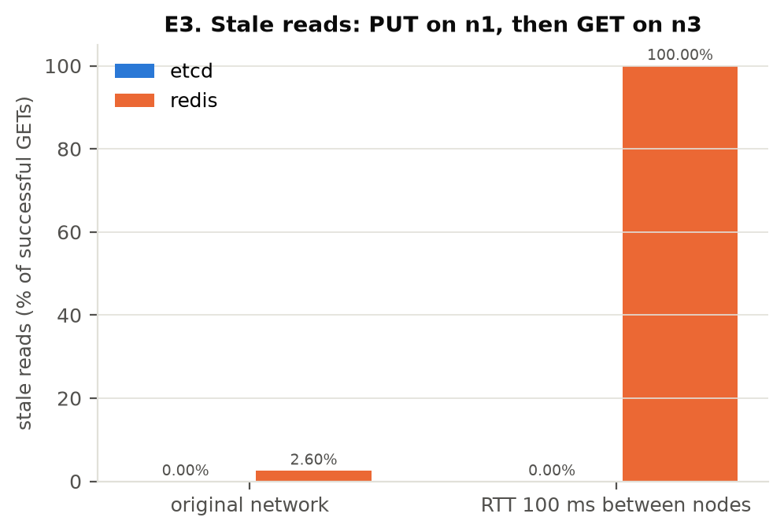
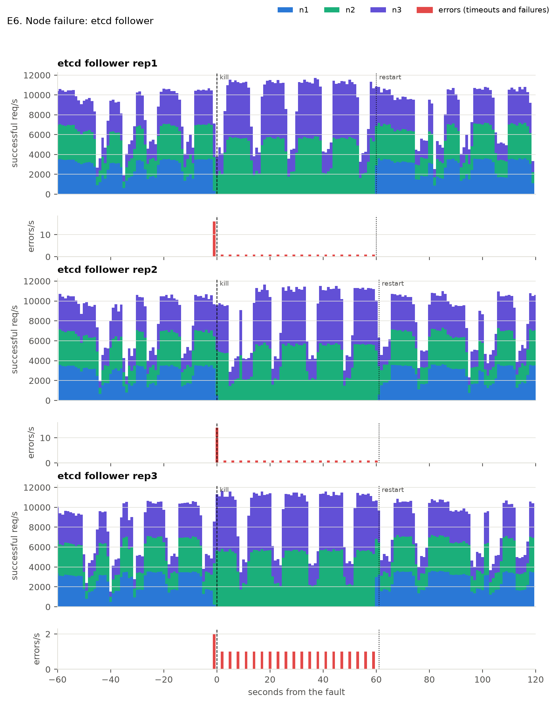
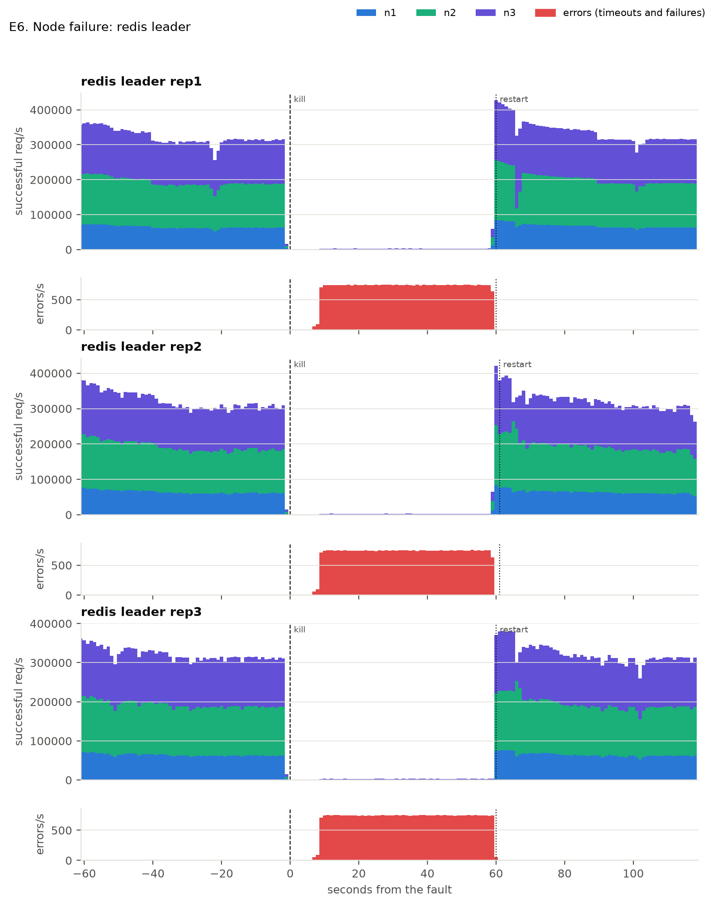
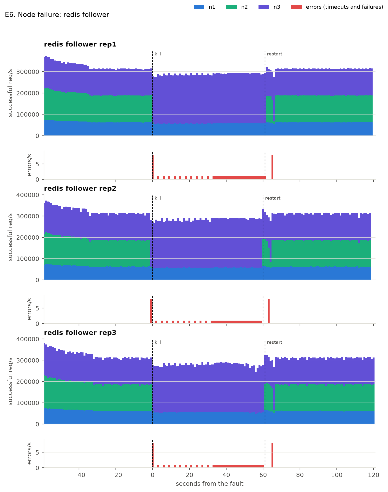

# Consistência, latência e vazão em armazenamento replicado

Trabalho 2 de Sistemas Distribuídos (4647B-04, PUCRS, 2026/2).
George Rother, Guilherme Hoffmann, João Sbardelotto.

Código, scripts e resultados: https://github.com/hoffmann-g/t2-sd

## 1. Sistemas e configuração

| | etcd (classe forte) | Redis (classe eventual) |
|---|---|---|
| Versão | 3.5.14 (`quay.io/coreos/etcd:v3.5.14`) | 7.4.11 (`redis:7.4.11`) |
| Replicação | Raft, 3 membros votantes | 1 primário (n1), 2 réplicas assíncronas (n2, n3) |
| Escrita | commit após gravação no log de 2 de 3 nós, com `fsync` | respondida pelo primário antes de chegar às réplicas |
| Leitura | linearizável (padrão): o nó confirma com o líder o índice de commit antes de responder (ReadIndex) | na réplica, sem coordenação: retorna o que a réplica já aplicou |
| Durabilidade | WAL com `fsync` a cada commit (padrão) | sem RDB nem AOF (`--save "" --appendonly no`) |
| Cliente | `go.etcd.io/etcd/client/v3` 3.5.35 (gRPC), uma conexão por nó | `github.com/redis/go-redis/v9` 9.23.0, pool de uma conexão por cliente |

A semântica de cada classe foi conferida na documentação: no etcd, `Range` sem a opção `serializable` é linearizável e `Put` só retorna após o commit pelo quórum; no Redis, a replicação é assíncrona por padrão e o `SET` é confirmado sem esperar réplica (documentação de replicação do Redis). As retentativas internas dos dois clientes foram desligadas, para que toda falha apareça nas amostras.

Topologia, igual à do enunciado: cada nó em duas redes Docker, `lab_cluster` (tráfego entre nós) e `lab_clientes` (tráfego do gerador). Latência e partição são aplicadas só na primeira. Sub-redes 172.30.0.0/24 e 172.31.0.0/24 (as do enunciado já estavam em uso na máquina).

Hardware: notebook com Intel Core i7-13620H (6 núcleos P + 4 E, 16 CPUs lógicas), 32 GB de RAM, SSD NVMe SK hynix (ext4), Arch Linux, kernel 7.2, Docker 29.6 com Compose 5.3. Cada nó foi preso a um núcleo físico (`cpuset`) e o gerador aos dez CPUs lógicos restantes. Governor `powersave` com EPP `performance`, na tomada. Nenhum outro contêiner ou carga durante as medições.

## 2. Gerador de carga e método

Gerador em Go, dentro do contêiner `gerador`. N clientes em laço fechado: sorteio da operação (80% GET, 20% PUT) e de uma chave uniforme entre 10.000, valor de 256 B, requisição a um nó, espera da resposta ou timeout de 2 s, registro da amostra (instante absoluto, latência, operação, nó, resultado), nova requisição sem pausa. Semente fixa: os dois sistemas recebem a mesma sequência por cliente. Timeout ou erro contam como erro e não têm latência. Os clientes alternam entre os nós que o sistema permite (todos no etcd; primário para escrita e réplicas para leitura no Redis), exceto no E5, em que cada cliente fica preso a um nó. A CPU de cada contêiner foi registrada a cada segundo.

Cada configuração foi executada 3 vezes, de cluster limpo. As tabelas trazem a mediana e, entre parênteses, o mínimo e o máximo. Percentis pelo método do posto mais próximo sobre as requisições bem-sucedidas da janela de medição (descartados os 30 s iniciais).

## 3. E1. Saturação


N de 1 a 512 nos dois sistemas e até 2.048 no etcd, 2 min por ponto, 3 repetições. Mediana das repetições; a variação entre elas ficou abaixo de 5% na vazão em todos os pontos. Tabela completa, com mínimo e máximo, CPU de cada nó e do gerador, em `results/e1/e1.md`.

| N | etcd req/s | etcd p99 (ms) | req/s por ms | Redis req/s | Redis p99 (ms) | req/s por ms |
|---:|---:|---:|---:|---:|---:|---:|
| 1 | 3.277 | 1,25 | 2.623 | 87.649 | 0,02 | 4,3 M |
| 2 | 4.242 | 5,18 | 819 | 129.825 | 0,03 | 4,1 M |
| 4 | 5.370 | 6,63 | 810 | 195.043 | 0,04 | 4,9 M |
| 8 | 6.556 | 7,89 | 831 | 304.618 | 0,05 | 6,5 M |
| 16 | 8.316 | 9,76 | 852 | 426.206 | 0,07 | 5,7 M |
| 32 | 10.885 | 15,60 | 698 | 488.276 | 0,17 | 2,9 M |
| 64 | 15.494 | 20,77 | 746 | 515.519 | 0,32 | 1,6 M |
| 128 | 21.281 | 31,29 | 680 | 521.994 | 0,65 | 0,8 M |
| 256 | 30.181 | 51,15 | 590 | 531.359 | 1,33 | 0,4 M |
| 512 | 44.125 | 64,35 | 686 | 509.345 | 3,13 | 0,16 M |
| 1024 | 56.598 | 98,81 | 573 | | | |
| 2048 | 64.604 | 145,82 | 443 | | | |

**Redis.** Ponto ótimo em N = 8: 304,6 mil req/s com p99 de 0,05 ms (6,5 M req/s por ms). Platô de N = 64 a 512, com vazão máxima sustentada de 531 mil req/s (N = 256); em N = 512 a vazão já cai e o p99 sobe para 3,1 ms. Os nós Redis usam de 0,5 a 0,6 núcleo cada no platô (o servidor é single-thread), enquanto os CPUs do gerador ficam entre 75% e 93% ocupados contando o tempo de kernel (29% de sistema e 15% de softirq no host inteiro durante a rodada). O platô do Redis é, portanto, o limite do gerador e da pilha de rede do host, não do banco: a vazão máxima do Redis nesta máquina é de pelo menos 531 mil req/s. Como os 16 CPUs lógicos já estavam todos alocados (6 aos nós, 10 ao gerador), não havia como adicionar um segundo processo gerador com capacidade própria.

**etcd.** A razão vazão/p99 é máxima em N = 1 (2.623 req/s por ms), que é o ponto sem contenção: o p99 salta de 1,25 ms para 5,2 ms já em N = 2, porque a leitura linearizável de um cliente passa a esperar o `fsync` da escrita do outro. Para N ≥ 2 a razão fica estável entre 590 e 852, com máximo em N = 16, e esse foi o N de referência dos experimentos E2 a E6 (um único cliente não exercita os três nós, e o E5 exige ao menos um cliente por nó). A vazão continua crescendo até N = 512 (44,1 mil req/s, p99 de 64 ms), sem platô, e a curva foi estendida: 56,6 mil req/s em N = 1.024 (p99 de 99 ms) e 64,6 mil em N = 2.048 (p99 de 146 ms), ainda sem erros. O crescimento desacelera (28% de 512 para 1.024, 14% de 1.024 para 2.048), mas não há dois pontos dentro de 5% um do outro, então o platô não foi alcançado; a vazão máxima observada é 64,6 mil req/s, e o limite prático da curva é o timeout de 2 s, do qual o p99 de 146 ms ainda está longe. A razão vazão/p99 cai de forma contínua a partir de N = 16. O gerador ficou abaixo de 15% de CPU em todos os pontos do etcd; o crescimento sem platô vem do agrupamento de propostas por `fsync`, analisado na pergunta 2.

## 4. E2 e E4. Latência por percentil



E2: 3 min sem falhas com o N de referência (16 no etcd, 8 no Redis). E4: a mesma carga com `tc netem delay 50ms` na interface da rede entre nós de cada nó, nos dois sentidos; o `ping` entre n1 e n2 antes de cada rodada mediu RTT de 100,1 a 100,2 ms. Janela de 150 s após 30 s de aquecimento, 3 repetições, mediana e (mínimo a máximo). Tabela completa em `results/e2/e2e4.csv`.

| sistema | exp. | op. | req/s | p50 (ms) | p95 (ms) | p99 (ms) | erros |
|---|---|---|---:|---:|---:|---:|---:|
| etcd | E2 | GET | 6.601 (6.556 a 6.776) | 1,45 | 5,53 (4,70 a 5,89) | 10,47 (9,43 a 10,62) | 0 |
| etcd | E2 | PUT | 1.655 (1.644 a 1.697) | 1,44 | 5,86 (4,51 a 6,18) | 9,56 (8,91 a 9,65) | 0 |
| etcd | E4 | GET | 52 (51 a 52) | 298,8 | 400,7 | 401,1 | 0 |
| etcd | E4 | PUT | 13 | 200,7 | 201,5 | 202,2 | 0 |
| Redis | E2 | GET | 248.005 (232.129 a 249.504) | 0,02 | 0,03 | 0,04 (0,04 a 0,05) | 0 |
| Redis | E2 | PUT | 61.990 (58.019 a 62.363) | 0,03 | 0,04 | 0,05 (0,05 a 0,06) | 0 |
| Redis | E4 | GET | 254.737 (253.928 a 255.872) | 0,02 | 0,04 | 0,08 (0,07 a 0,08) | 0 |
| Redis | E4 | PUT | 63.677 (63.473 a 63.961) | 0,02 | 0,03 | 0,04 | 0 |

No etcd a vazão caiu de 8,3 mil para 65 req/s (127 vezes) com o mesmo N, e a latência passou a ser um múltiplo exato do RTT. Por nó (repetição 1): no líder (n2), PUT p50 de 100,8 ms e GET p50 de 102,8 ms; nos seguidores, PUT de 200,8 ms e GET de 300,8 ms, com p99 de GET em 401 ms. A variação entre repetições ficou abaixo de 1 ms. No Redis nada mudou: vazão e percentis do E4 ficaram dentro da faixa do E2 (a vazão até subiu 3%, dentro da variação entre repetições), porque o cliente fala com o primário pela rede sem atraso e a escrita é confirmada antes de qualquer mensagem às réplicas. O atraso só afetou a replicação, que não está no caminho da requisição.

## 5. E3. Stale reads



Coordenador: PUT(k, v) com v crescente no n1; quando o PUT retorna com sucesso, GET(k) no n3. Stale read: valor lido menor que o último v confirmado. PUT com erro não eleva o valor esperado. 10.000 pares por condição e repetição, divididos em 20 coordenadores simultâneos com chaves próprias (no etcd com atraso cada par leva 0,5 s), 3 repetições de cluster limpo.

| sistema | rede | pares | stale reads | taxa | atraso máx. (escritas) | PUT p50 (ms) | GET p50 (ms) |
|---|---|---:|---:|---:|---:|---:|---:|
| etcd | original | 30.000 | 0 | 0,00% | 0 | 0,7 | 0,16 |
| etcd | RTT 100 ms | 30.000 | 0 | 0,00% | 0 | 102 (n1 líder) ou 202 | 199 ou 299 |
| Redis | original | 30.000 | 1.495 | 2,60% (1,72% a 10,63%) | 1 | 0,04 | 0,03 |
| Redis | RTT 100 ms | 30.000 | 30.000 | 100,00% | 500 | 0,03 | 0,03 |

Configuração de consistência usada: no etcd, PUT confirmado pelo quórum e GET linearizável; no Redis, PUT confirmado pelo primário e GET na réplica n3 sem nível de consistência configurável.

## 6. E5. Partição de rede


Carga do E2 com cada cliente preso a um nó (16 clientes no etcd: 6 no n1 e 5 em cada outro; 8 no Redis: 3 no n1, 3 no n2, 2 no n3). Aos 60 s, `docker network disconnect` tira o n1 da rede entre nós (ele continua na rede dos clientes); aos 120 s o n1 é reconectado; a carga vai até 180 s. Antes de cada medição foi verificado que n2 alcança n3, n1 não alcança n2 e o gerador alcança n1. Depois da carga, `check` lê todas as chaves em todos os nós e compara com as escritas confirmadas da rodada. Nas três repetições do etcd, o líder era n3, e n1 um seguidor. As figuras mostram as requisições atendidas por segundo por nó e os erros por segundo; a tabela traz os totais por fase da repetição 3 (as três são equivalentes; todas em `results/e5/e5.csv`).

| sistema | fase | n1 (isolado) | n2 e n3 |
|---|---|---|---|
| etcd | 60 s de partição | GET 2.461 ok / 137 erros; PUT 646 ok / 37 erros; sem resposta em 29 dos 60 s (os ok são do primeiro segundo, antes de o nó perder o líder) | GET 371.684 ok, PUT 93.093 ok, 0 erros |
| etcd | 60 s após a cura | GET 126.556 ok, PUT 31.458 ok, 0 a 4 erros | 0 erros |
| Redis | 60 s de partição | GET 5.818.667 ok, PUT 4.000.556 ok, 0 erros (primário isolado continua aceitando escritas) | GET 10,2 milhões ok, 0 erros (réplicas sem contato com o primário continuam lendo o estado anterior) |
| Redis | 60 s após a cura | 0 erros | 4 a 5 erros de GET (reconexão das réplicas na ressincronização) |

Convergência após a cura, três repetições, nos dois sistemas: 0 chaves divergentes entre os nós, 0 escritas confirmadas perdidas, 0 valores desconhecidos (os únicos valores fora das amostras, 0 a 6 por rodada, são de requisições ainda em voo quando a carga terminou). No Redis a convergência vem da ressincronização parcial: ao reconectar, cada réplica informa seu offset e o primário reenvia o trecho do fluxo de replicação que ela perdeu durante os 60 s.

## 7. E6. Falha de nó






Carga do E2, clientes alternando entre os três nós. Aos 60 s, `docker kill` no nó escolhido; aos 120 s, `docker start`; carga até 180 s. Variante (a): o líder do etcd (identificado antes de matar) ou o primário do Redis (n1). Variante (b): um seguidor ou uma réplica. Tempo de failover: do `kill` até a conclusão da primeira escrita enviada depois dele que teve sucesso, medido nas amostras.

| sistema | nó morto | failover de escrita (s) | erros nos 60 s de falha | req/s na falha | req/s antes | erros nos 60 s após reinício |
|---|---|---:|---:|---:|---:|---:|
| etcd | líder (n2 ou n3) | 1,11 (0,87 a 1,26) | 24 (21 a 32) | 8.804 | 8.076 | 0 |
| etcd | seguidor (n1) | 0,002 (0,001 a 0,004) | 20 | 9.056 | 8.526 | 0 |
| Redis | primário (n1) | 60,67 (60,63 a 60,88) | 38.097 (38.045 a 38.198) | 3.483 | 298.950 | 12 (11 a 68) |
| Redis | réplica (n2) | 0,000 | 38 | 285.170 | 311.311 | 8 |

No Redis com o primário morto não há failover: as 38 mil falhas são as escritas dos 60 s, e a primeira escrita bem-sucedida veio 0,7 s depois do `docker start` (60,67 s após o `kill`). Nos primeiros 4 s nenhum nó respondeu nada: o contêiner morto some da rede sem fechar as conexões, e cada escrita pendente esperou o timeout de 2 s; depois disso a falha passou a ser imediata (rota inexistente) e os clientes voltaram a ler nas réplicas entre uma escrita falha e outra. A vazão de leitura também caiu (3,5 mil req/s contra 299 mil) porque, em laço fechado, cada cliente gasta a maior parte do tempo na escrita que falha e na pausa de 10 ms após erro: é um efeito do gerador, não das réplicas, que responderam tudo o que receberam sem erro. Com a réplica n2 morta, as escritas não foram afetadas, as leituras passaram todas para n3 e os únicos erros foram as sondas ao nó fora.

No etcd, os erros da fase de falha são as requisições que estavam no nó morto no instante do `kill` (6 a 7 por rodada, "leader changed" ou conexão fechada) e as sondas periódicas que o gerador manda ao nó fora para detectar sua volta (uma por segundo). A vazão com dois nós é igual ou maior que com três, porque os clientes passam a alternar entre dois nós vivos sem esperar timeouts. O reinício do nó não causou erro: ele volta como seguidor, recebe o log perdido do líder e passa a responder.

## 8. Perguntas

### 8.1 Latência de escrita e vazão com rede lenta (E4)

No etcd cada operação virou um número inteiro de RTTs, e a vazão em laço fechado caiu na mesma proporção (16 clientes divididos por cerca de 250 ms de latência média dão os 65 req/s medidos).

Escrita no líder, 1 RTT (100 ms): o líder anexa a proposta ao log e manda `AppendEntries` aos seguidores (50 ms); a confirmação de um deles fecha o quórum de 2 em 3 (mais 50 ms); o líder aplica e responde. É a rodada de "escrita" do consenso de época em CGR §5.3: a decisão exige aceite de um quórum, e o líder não pode responder antes. Escrita num seguidor, 2 RTTs (200 ms): o seguidor encaminha a proposta ao líder (50 ms), segue a rodada de 100 ms, e o seguidor só responde depois de saber o commit, que chega no `AppendEntries` seguinte (50 ms).

Leitura linearizável no líder, 1 RTT (100 ms): antes de responder, o líder confirma que ainda é líder com uma rodada de heartbeat ao quórum (ReadIndex), para não servir uma leitura obsoleta se tiver sido deposto. Leitura num seguidor, 3 RTTs (300 ms): o pedido de ReadIndex vai ao líder (50 ms), o líder faz a rodada de heartbeat (100 ms) e devolve o índice (50 ms); o seguidor ainda precisa ter aplicado o log até esse índice, e com escritas em andamento isso espera o próximo commit propagado (mais 100 ms). O p99 de 401 ms corresponde ao caso de dois commits de espera.

No Redis a latência e a vazão não mudaram (GET p99 de 0,04 para 0,08 ms, PUT igual): a escrita é confirmada pelo primário sem esperar réplica e o cliente está na rede sem atraso, então o atraso entre nós não entra no caminho da requisição; ele só aumenta o atraso de replicação, que aparece no E3 como stale reads.

### 8.2 O que limitou a vazão no E1

No etcd, o gargalo é o log do Raft em disco. Cada commit exige que o líder e ao menos um seguidor gravem a entrada no WAL com `fsync` antes de responder (CGR §5.3, consenso dirigido por líder: a decisão só vale depois de aceita por um quórum; o etcd torna essa aceitação durável). As métricas dos nós mostram o `fsync` em 0,6 ms de média com N pequeno, e o número de `fsync` por segundo satura em torno de 1.250 por nó a partir de N = 16. Como o WAL é escrito sequencialmente, isso limita o número de rodadas de consenso por segundo; o que permite a vazão seguir subindo é o agrupamento: o etcd grava várias propostas por `fsync`, e a medição mostra de 1,0 proposta por `fsync` em N = 1 para 12 em N = 512, à custa do tempo de espera no lote (p99 de PUT de 6 ms para 43 ms). As leituras linearizáveis pagam o mesmo caminho: cada GET pede ao líder o índice de commit (ReadIndex) e espera que o nó aplique as entradas até ele, por isso o p99 de GET acompanha o de PUT em vez de ficar no custo de uma leitura local.

O consenso restringe o scale-out de escritas porque toda escrita passa pelo líder e pelo quórum: adicionar nós não adiciona capacidade de escrita, só aumenta o número de mensagens por rodada, e o líder serializa a ordem total (CGR §6.1, difusão com ordem total construída sobre consenso). Características da implementação que pesaram, além do protocolo: a durabilidade com `fsync` síncrono (o protocolo em si não exige disco), o agrupamento de propostas, o uso de gRPC com uma conexão por nó e o fato de o ReadIndex atrelar leituras ao ritmo do apply.

No Redis, a vazão foi limitada pelo gerador e pela pilha de rede do host, não pelo banco (Seção 3): cada nó Redis é single-thread e ficou em 0,5–0,6 núcleo. A escrita não espera réplica nem disco, então o custo por operação é o de um ciclo do laço de eventos, e as leituras se espalham por dois nós sem coordenação. Não há limite de protocolo; o limite é a CPU do nó que atende cada requisição.

### 8.3 Stale reads observados

No etcd, nenhum em 60.000 pares, com e sem atraso. É o esperado: o GET linearizável no n3 consulta o índice de commit do líder e espera o nó aplicar o log até ele, logo vê todo PUT que já retornou. O atraso de rede só muda o tempo da leitura (de 0,16 ms para 200 ou 300 ms), não o resultado. Qualquer anomalia aqui indicaria erro de configuração (por exemplo, leitura `serializable`); em teste prévio com essa opção, 19% das leituras no n3 foram stale.

No Redis, 2,6% de leituras obsoletas com a rede original (1,7% a 10,6% conforme a repetição, sempre com atraso de uma única escrita) e 100% com RTT de 100 ms, com a leitura chegando a 500 escritas confirmadas atrás (todas as escritas do coordenador). A escrita retorna assim que o primário a aplica; a réplica só a recebe depois do tempo de propagação, então a janela de leitura obsoleta é igual à latência entre n1 e n3 (50 ms com o `netem`). Sem atraso, na mesma máquina, a réplica aplica a escrita em dezenas de microssegundos, da ordem do tempo que a leitura leva para chegar, por isso só uma pequena fração das leituras é obsoleta e sempre por uma escrita; a repetição com 10,6% coincide com os 20 coordenadores simultâneos acumulando fila no fluxo de replicação.

### 8.4 Partição: escritas e leituras de cada lado, C ou A, reconciliação

etcd. O lado majoritário (n2 e n3, com o líder) não percebeu a partição: 0 erros e a mesma vazão. O lado isolado (n1, um seguidor) parou de responder no primeiro segundo: sem contato com o líder, não pode confirmar escritas (não há quórum) nem servir leituras linearizáveis (o ReadIndex não chega ao líder), e cada requisição espera até o timeout de 2 s. Nenhuma escrita foi aceita no lado minoritário. O etcd prioriza C: a indisponibilidade de n1 é o preço de não responder com estado possivelmente obsoleto. Na reconciliação não há conflito: n1 reconecta como seguidor, recebe as entradas de log que perdeu e volta a responder em segundos (0 a 4 erros após a cura); a verificação não achou divergência nem escrita confirmada perdida. Se n1 fosse o líder no momento da partição, ele deporia a si mesmo ao perder os heartbeats do quórum e os outros dois elegeriam um novo líder, com o mesmo resultado para os clientes de n1.

Redis. Nenhum dos lados deu erro durante os 60 s: n1 recebeu 4,0 milhões de escritas e 5,8 milhões de leituras isolado, e as réplicas serviram 10,2 milhões de leituras. A configuração não tem failover: n1 é o primário fixo, continua aceitando escritas isolado, e as réplicas, sem contato com ele, continuam servindo leituras com o estado anterior à partição. Nenhum lado dá erro, e o sistema prioriza A: disponibilidade total, ao custo de leituras obsoletas em n2 e n3 durante 60 s. Na cura, as réplicas se ressincronizam com o primário (replicação parcial a partir do offset) e o estado converge. Não houve escritas perdidas porque só existe um nó que escreve; com failover automático (Sentinel), uma réplica poderia ser promovida durante a partição e as escritas aceitas pelo antigo primário seriam descartadas na reconciliação.

### 8.5 Tempo de failover e o que o determinou

etcd, líder morto: 1,11 s (0,87 a 1,26). O tempo é dominado pelo timeout de eleição do Raft, 1.000 ms por padrão no etcd (com heartbeat de 100 ms): um seguidor só se candidata depois de passar esse intervalo sem heartbeat, e a eleição em si (um RTT de rede local) e a notificação ao cliente somam poucos milissegundos. A detecção de falha é por ausência de heartbeat, como o detector de defeitos eventualmente perfeito que sustenta o consenso no modelo fail-noisy (CGR §2.6 e §5.3): o timeout tem que ser maior que o atraso normal entre nós, sob pena de eleições espúrias, e por isso fica na casa do segundo. Os clientes não precisaram de reconfiguração: como o gerador conhece os três endereços e qualquer nó aceita escritas, a primeira escrita bem-sucedida foi em outro nó.

etcd, seguidor morto: 2 ms. Não há failover: o quórum (líder mais um seguidor) continua, e o tempo medido é só o de o gerador redirecionar a requisição seguinte a outro nó.

Redis, primário morto: 60,67 s, ou seja, 0,7 s depois do `docker start` aos 60 s. Sem Sentinel, não há eleição; as escritas falham até o `docker start` (60 s), e o tempo de failover é o tempo de reinício mais a reconexão do cliente. Redis, réplica morta: 0 s; as escritas vão ao primário e não são afetadas; as leituras passam à outra réplica.

### 8.6 Modelo de consistência ou implementação

As diferenças de ordem de grandeza são do modelo. Três evidências: (1) no E4, a latência do etcd é um múltiplo inteiro do RTT entre nós (1, 2 ou 3 RTTs conforme o papel do nó e a operação), o que é a contagem de rodadas de mensagens do protocolo, independente de código; o Redis não muda, porque seu caminho de requisição não cruza a rede entre nós. (2) No E3, 0 stale reads no etcd em qualquer condição e 2,6% a 100% no Redis conforme a distância entre os nós, que é a definição dos dois modelos: linearizável contra eventual. (3) No E5, um lado do etcd para e nenhum lado do Redis para, que é a escolha C contra A que o modelo impõe a qualquer implementação com a mesma semântica. Esses três resultados se repetiriam com Consul ou Zookeeper de um lado e Cassandra com CL=ONE do outro.

Os valores absolutos são da implementação e do ambiente. No etcd: o `fsync` a cada commit (durabilidade além do que o consenso exige), o agrupamento de propostas que faz a vazão crescer com N, o timeout de eleição de 1 s que fixa o failover, o ReadIndex que amarra as leituras ao apply. No Redis: o servidor single-thread, o protocolo de texto leve, e a ausência de failover na configuração usada, que é uma escolha de topologia e não do modelo (com Sentinel o E6 teria uma eleição e o E5 poderia perder escritas). No ambiente: os dois clusters rodam na mesma máquina, sem latência real entre nós, o que faz o custo do consenso parecer pequeno em valor absoluto no E2 (p99 de 10 ms) e só aparecer com clareza no E4; e o platô do Redis é o do gerador, não do banco.

## 9. Reprodução

```sh
lab/scripts/e1.sh etcd; lab/scripts/e1.sh redis    # E1, 70 min cada
lab/scripts/rest.sh 16 8                            # E2 a E6 com o N de referência, cerca de 2 h
go run ./cmd/analyze all      # tabelas (results/analysis.md e CSV)
cd plots && uv run plots      # figuras
go run ./cmd/viz              # demonstração ao vivo (http://localhost:8080)
```

Detalhes de cada script e dos arquivos gerados no [README](README.md).
