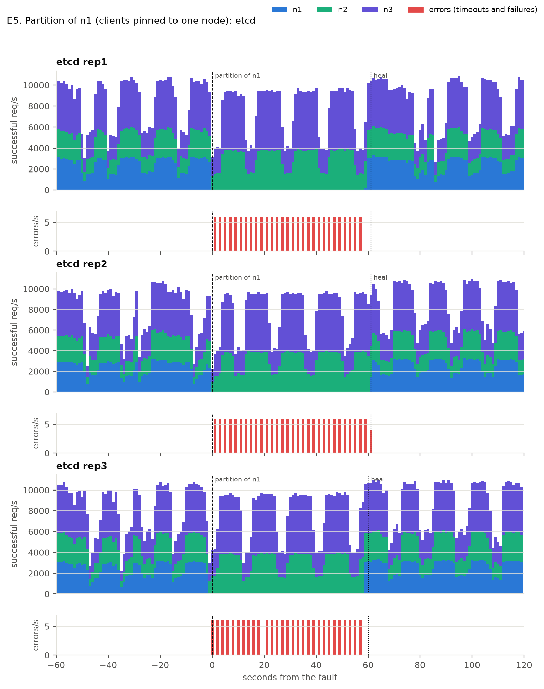
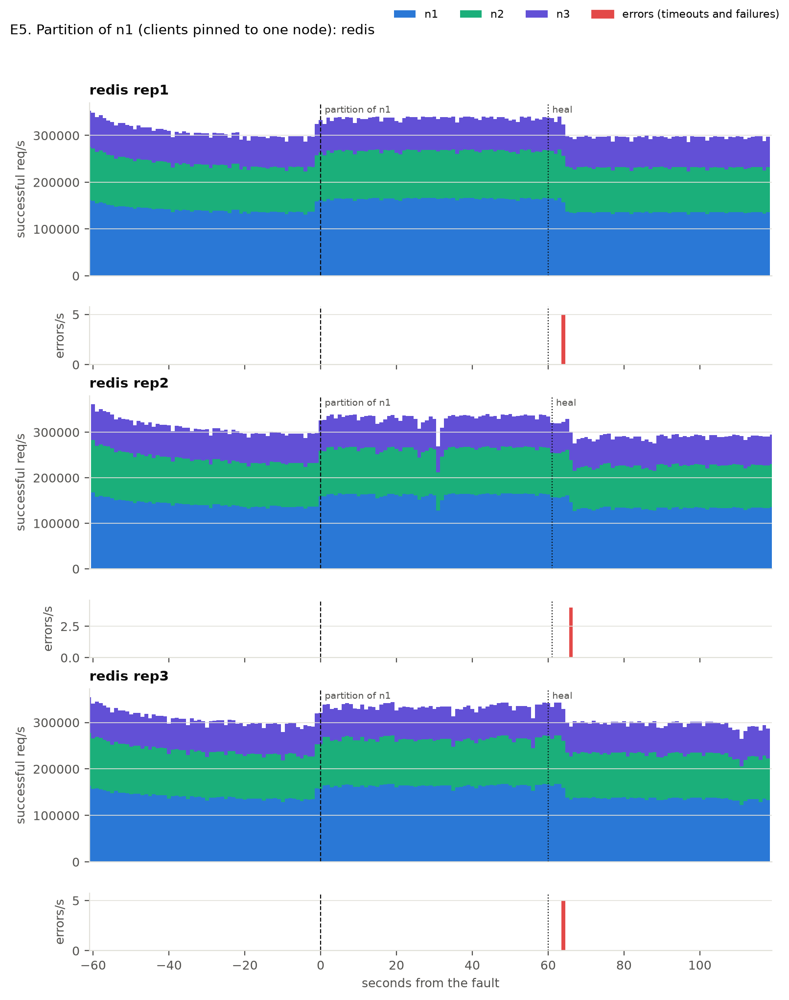

# Consistência, latência e vazão em armazenamento replicado

Trabalho 2 de Sistemas Distribuídos (4647B-04, PUCRS, 2026/2).
George Rother, Guilherme Hoffmann, João Sbardelotto.

Código, scripts e resultados: https://github.com/hoffmann-g/t2-sd

## 1. Sistemas e configuração

| | etcd (classe forte) | Redis (classe eventual) |
|---|---|---|
| Versão | 3.5.14 (`quay.io/coreos/etcd:v3.5.14`) | 7.4.11 (`redis:7.4.11`) |
| Replicação | Raft, 3 membros votantes | 1 primário (n1), 2 réplicas assíncronas (n2, n3) |
| Escrita | commit após gravação no log de 2 de 3 nós, com `fsync` | respondida pelo primário antes de chegar às réplicas |
| Leitura | linearizável (padrão): o nó confirma com o líder o índice de commit antes de responder (ReadIndex) | na réplica, sem coordenação: retorna o que a réplica já aplicou |
| Durabilidade | WAL com `fsync` a cada commit (padrão) | sem RDB nem AOF (`--save "" --appendonly no`) |
| Cliente | `go.etcd.io/etcd/client/v3` 3.5.35 (gRPC), uma conexão por nó | `github.com/redis/go-redis/v9` 9.23.0, pool de uma conexão por cliente |

A semântica de cada classe foi conferida na documentação: no etcd, `Range` sem a opção `serializable` é linearizável e `Put` só retorna após o commit pelo quórum; no Redis, a replicação é assíncrona por padrão e o `SET` é confirmado sem esperar réplica (documentação de replicação do Redis). As retentativas internas dos dois clientes foram desligadas, para que toda falha apareça nas amostras.

Topologia, igual à do enunciado: cada nó em duas redes Docker, `lab_cluster` (tráfego entre nós) e `lab_clientes` (tráfego do gerador). Latência e partição são aplicadas só na primeira. Sub-redes 172.30.0.0/24 e 172.31.0.0/24 (as do enunciado já estavam em uso na máquina).

Hardware: notebook com Intel Core i7-13620H (6 núcleos P + 4 E, 16 CPUs lógicas), 32 GB de RAM, SSD NVMe SK hynix (ext4), Arch Linux, kernel 7.2, Docker 29.6 com Compose 5.3. Cada nó foi preso a um núcleo físico (`cpuset`) e o gerador aos dez CPUs lógicos restantes. Governor `powersave` com EPP `performance`, na tomada. Nenhum outro contêiner ou carga durante as medições.

## 2. Gerador de carga e método

Gerador em Go, dentro do contêiner `gerador`. N clientes em laço fechado: sorteio da operação (80% GET, 20% PUT) e de uma chave uniforme entre 10.000, valor de 256 B, requisição a um nó, espera da resposta ou timeout de 2 s, registro da amostra (instante absoluto, latência, operação, nó, resultado), nova requisição sem pausa. Semente fixa: os dois sistemas recebem a mesma sequência por cliente. Timeout ou erro contam como erro e não têm latência. Os clientes alternam entre os nós que o sistema permite (todos no etcd; primário para escrita e réplicas para leitura no Redis), exceto no E5, em que cada cliente fica preso a um nó. A CPU de cada contêiner foi registrada a cada segundo.

Cada configuração foi executada 3 vezes, de cluster limpo. As tabelas trazem a mediana e, entre parênteses, o mínimo e o máximo. Percentis pelo método do posto mais próximo sobre as requisições bem-sucedidas da janela de medição (descartados os 30 s iniciais).

## 3. E1. Saturação


N de 1 a 512, 2 min por ponto, 3 repetições. Mediana das repetições; a variação entre elas ficou abaixo de 5% na vazão em todos os pontos. Tabela completa, com mínimo e máximo, CPU de cada nó e do gerador, em `results/e1/e1.md`.

| N | etcd req/s | etcd p99 (ms) | req/s por ms | Redis req/s | Redis p99 (ms) | req/s por ms |
|---:|---:|---:|---:|---:|---:|---:|
| 1 | 3.277 | 1,25 | 2.623 | 87.649 | 0,02 | 4,3 M |
| 2 | 4.242 | 5,18 | 819 | 129.825 | 0,03 | 4,1 M |
| 4 | 5.370 | 6,63 | 810 | 195.043 | 0,04 | 4,9 M |
| 8 | 6.556 | 7,89 | 831 | 304.618 | 0,05 | 6,5 M |
| 16 | 8.316 | 9,76 | 852 | 426.206 | 0,07 | 5,7 M |
| 32 | 10.885 | 15,60 | 698 | 488.276 | 0,17 | 2,9 M |
| 64 | 15.494 | 20,77 | 746 | 515.519 | 0,32 | 1,6 M |
| 128 | 21.281 | 31,29 | 680 | 521.994 | 0,65 | 0,8 M |
| 256 | 30.181 | 51,15 | 590 | 531.359 | 1,33 | 0,4 M |
| 512 | 44.125 | 64,35 | 686 | 509.345 | 3,13 | 0,16 M |
| 1024 | (preencher) | | | | | |
| 2048 | (preencher) | | | | | |

**Redis.** Ponto ótimo em N = 8: 304,6 mil req/s com p99 de 0,05 ms (6,5 M req/s por ms). Platô de N = 64 a 512, com vazão máxima sustentada de 531 mil req/s (N = 256); em N = 512 a vazão já cai e o p99 sobe para 3,1 ms. Os nós Redis usam de 0,5 a 0,6 núcleo cada no platô (o servidor é single-thread), enquanto os CPUs do gerador ficam entre 75% e 93% ocupados contando o tempo de kernel (29% de sistema e 15% de softirq no host inteiro durante a rodada). O platô do Redis é, portanto, o limite do gerador e da pilha de rede do host, não do banco: a vazão máxima do Redis nesta máquina é de pelo menos 531 mil req/s. Como os 16 CPUs lógicos já estavam todos alocados (6 aos nós, 10 ao gerador), não havia como adicionar um segundo processo gerador com capacidade própria.

**etcd.** A razão vazão/p99 é máxima em N = 1 (2.623 req/s por ms), que é o ponto sem contenção: o p99 salta de 1,25 ms para 5,2 ms já em N = 2, porque a leitura linearizável de um cliente passa a esperar o `fsync` da escrita do outro. Para N ≥ 2 a razão fica estável entre 590 e 852, com máximo em N = 16, e esse foi o N de referência dos experimentos E2 a E6 (um único cliente não exercita os três nós, e o E5 exige ao menos um cliente por nó). A vazão continua crescendo até N = 512 (44,1 mil req/s, p99 de 64 ms), sem platô; a curva foi estendida com N = 1.024 e 2.048 (preencher: resultado da extensão e vazão máxima sustentada). O gerador ficou abaixo de 15% de CPU em todos os pontos do etcd.

## 4. E2 e E4. Latência por percentil


(preencher: tabela e4e2; RTT medido; comentário)

## 5. E3. Stale reads


(preencher: tabela e3)

Configuração de consistência usada: no etcd, PUT confirmado pelo quórum e GET linearizável; no Redis, PUT confirmado pelo primário e GET na réplica n3 sem nível de consistência configurável.

## 6. E5. Partição de rede




(preencher: tabela por lado; verificação de convergência)

## 7. E6. Falha de nó


(preencher: tabela de failover)

## 8. Perguntas

### 8.1 Latência de escrita e vazão com rede lenta (E4)

(preencher)

### 8.2 O que limitou a vazão no E1

No etcd, o gargalo é o log do Raft em disco. Cada commit exige que o líder e ao menos um seguidor gravem a entrada no WAL com `fsync` antes de responder (CGR §5.3, consenso dirigido por líder: a decisão só vale depois de aceita por um quórum; o etcd torna essa aceitação durável). As métricas dos nós mostram o `fsync` em 0,6 ms de média com N pequeno, e o número de `fsync` por segundo satura em torno de 1.250 por nó a partir de N = 16. Como o WAL é escrito sequencialmente, isso limita o número de rodadas de consenso por segundo; o que permite a vazão seguir subindo é o agrupamento: o etcd grava várias propostas por `fsync`, e a medição mostra de 1,0 proposta por `fsync` em N = 1 para 12 em N = 512, à custa do tempo de espera no lote (p99 de PUT de 6 ms para 43 ms). As leituras linearizáveis pagam o mesmo caminho: cada GET pede ao líder o índice de commit (ReadIndex) e espera que o nó aplique as entradas até ele, por isso o p99 de GET acompanha o de PUT em vez de ficar no custo de uma leitura local.

O consenso restringe o scale-out de escritas porque toda escrita passa pelo líder e pelo quórum: adicionar nós não adiciona capacidade de escrita, só aumenta o número de mensagens por rodada, e o líder serializa a ordem total (CGR §6.1, difusão com ordem total construída sobre consenso). Características da implementação que pesaram, além do protocolo: a durabilidade com `fsync` síncrono (o protocolo em si não exige disco), o agrupamento de propostas, o uso de gRPC com uma conexão por nó e o fato de o ReadIndex atrelar leituras ao ritmo do apply.

No Redis, a vazão foi limitada pelo gerador e pela pilha de rede do host, não pelo banco (Seção 3): cada nó Redis é single-thread e ficou em 0,5–0,6 núcleo. A escrita não espera réplica nem disco, então o custo por operação é o de um ciclo do laço de eventos, e as leituras se espalham por dois nós sem coordenação. Não há limite de protocolo; o limite é a CPU do nó que atende cada requisição.

### 8.3 Stale reads observados

(preencher)

### 8.4 Partição: escritas e leituras de cada lado, C ou A, reconciliação

(preencher)

### 8.5 Tempo de failover e o que o determinou

(preencher)

### 8.6 Modelo de consistência ou implementação

(preencher)

## 9. Reprodução

```sh
lab/scripts/all.sh            # série completa, cerca de 4 h
go run ./cmd/analyze all      # tabelas (results/analysis.md e CSV)
cd plots && uv run plots      # figuras
go run ./cmd/viz              # demonstração ao vivo (http://localhost:8080)
```

Detalhes de cada script e dos arquivos gerados no [README](README.md).
