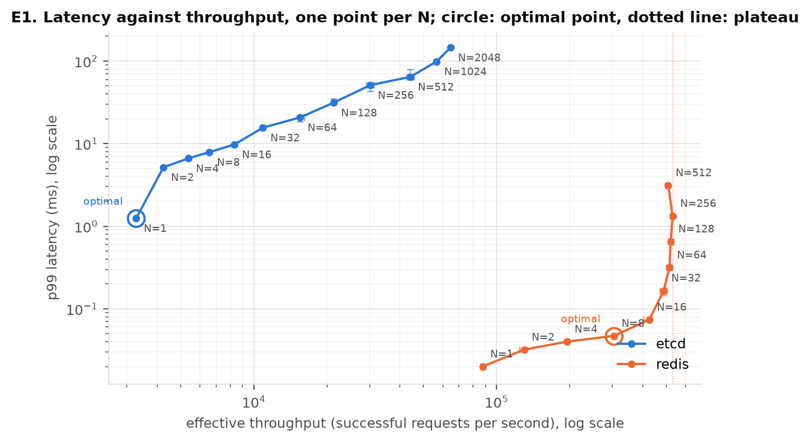
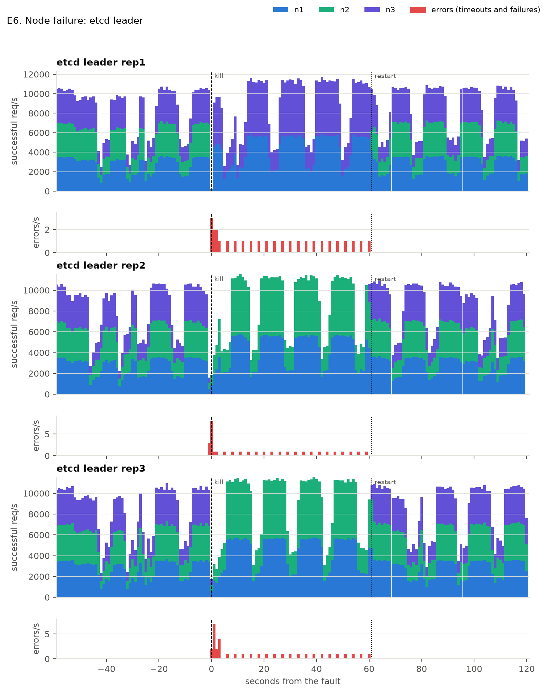

# Consistência, latência e vazão em armazenamento replicado

Trabalho 2 de Sistemas Distribuídos (4647B-04, PUCRS, 2026/2).
George Rother, Guilherme Hoffmann, João Sbardelotto.

Código, scripts e resultados: https://github.com/hoffmann-g/t2-sd

## 1. Sistemas e configuração

| | etcd (classe forte) | Redis (classe eventual) |
|---|---|---|
| Versão | 3.5.14 (`quay.io/coreos/etcd:v3.5.14`) | 7.4.11 (`redis:7.4.11`) |
| Replicação | Raft, 3 membros votantes | 1 primário (n1), 2 réplicas assíncronas (n2, n3) |
| Escrita | commit após gravação no log de 2 de 3 nós, com `fsync` | respondida pelo primário antes de chegar às réplicas |
| Leitura | linearizável (padrão): o nó confirma com o líder o índice de commit antes de responder (ReadIndex) | na réplica, sem coordenação: retorna o que a réplica já aplicou |
| Durabilidade | WAL com `fsync` a cada commit (padrão) | sem RDB nem AOF (`--save "" --appendonly no`) |
| Cliente | `go.etcd.io/etcd/client/v3` 3.5.35 (gRPC), uma conexão por nó | `github.com/redis/go-redis/v9` 9.23.0, pool de uma conexão por cliente |

A semântica de cada classe foi conferida na documentação: no etcd, `Range` sem a opção `serializable` é linearizável e `Put` só retorna após o commit pelo quórum; no Redis, a replicação é assíncrona por padrão e o `SET` é confirmado sem esperar réplica (documentação de replicação do Redis). As retentativas internas dos dois clientes foram desligadas, para que toda falha apareça nas amostras.

Topologia, igual à do enunciado: cada nó em duas redes Docker, `lab_cluster` (tráfego entre nós) e `lab_clientes` (tráfego do gerador). Latência e partição são aplicadas só na primeira. Sub-redes 172.30.0.0/24 e 172.31.0.0/24 (as do enunciado já estavam em uso na máquina).

Hardware: notebook com Intel Core i7-13620H (6 núcleos P + 4 E, 16 CPUs lógicas), 32 GB de RAM, SSD NVMe SK hynix (ext4), Arch Linux, kernel 7.2, Docker 29.6 com Compose 5.3. Cada nó foi preso a um núcleo físico (`cpuset`) e o gerador aos dez CPUs lógicos restantes. Governor `powersave` com EPP `performance`, na tomada. Nenhum outro contêiner ou carga durante as medições.

## 2. Gerador de carga e método

Gerador em Go, dentro do contêiner `gerador`. N clientes em laço fechado: sorteio da operação (80% GET, 20% PUT) e de uma chave uniforme entre 10.000, valor de 256 B, requisição a um nó, espera da resposta ou timeout de 2 s, registro da amostra (instante absoluto, latência, operação, nó, resultado), nova requisição sem pausa. Semente fixa: os dois sistemas recebem a mesma sequência por cliente. Timeout ou erro contam como erro e não têm latência. Os clientes alternam entre os nós que o sistema permite (todos no etcd; primário para escrita e réplicas para leitura no Redis), exceto no E5, em que cada cliente fica preso a um nó. A CPU de cada contêiner foi registrada a cada segundo.

Cada configuração foi executada 3 vezes, de cluster limpo. As tabelas trazem a mediana e, entre parênteses, o mínimo e o máximo. Percentis pelo método do posto mais próximo sobre as requisições bem-sucedidas da janela de medição (descartados os 30 s iniciais).

## 3. E1. Saturação



(preencher: tabela resumida por sistema com N, req/s, p99, razão; N ótimo, razão vazão/p99 nesse ponto e vazão máxima sustentada; observação sobre a CPU do gerador no Redis)

## 4. E2 e E4. Latência por percentil


(preencher: tabela e4e2; RTT medido; comentário)

## 5. E3. Stale reads


(preencher: tabela e3)

Configuração de consistência usada: no etcd, PUT confirmado pelo quórum e GET linearizável; no Redis, PUT confirmado pelo primário e GET na réplica n3 sem nível de consistência configurável.

## 6. E5. Partição de rede


(preencher: tabela por lado; verificação de convergência)

## 7. E6. Falha de nó




(preencher: tabela de failover)

## 8. Perguntas

### 8.1 Latência de escrita e vazão com rede lenta (E4)

(preencher)

### 8.2 O que limitou a vazão no E1

(preencher)

### 8.3 Stale reads observados

(preencher)

### 8.4 Partição: escritas e leituras de cada lado, C ou A, reconciliação

(preencher)

### 8.5 Tempo de failover e o que o determinou

(preencher)

### 8.6 Modelo de consistência ou implementação

(preencher)

## 9. Reprodução

```sh
lab/scripts/all.sh            # série completa, cerca de 4 h
go run ./cmd/analyze all      # tabelas (results/analysis.md e CSV)
cd plots && uv run plots      # figuras
go run ./cmd/viz              # demonstração ao vivo (http://localhost:8080)
```

Detalhes de cada script e dos arquivos gerados no [README](README.md).
